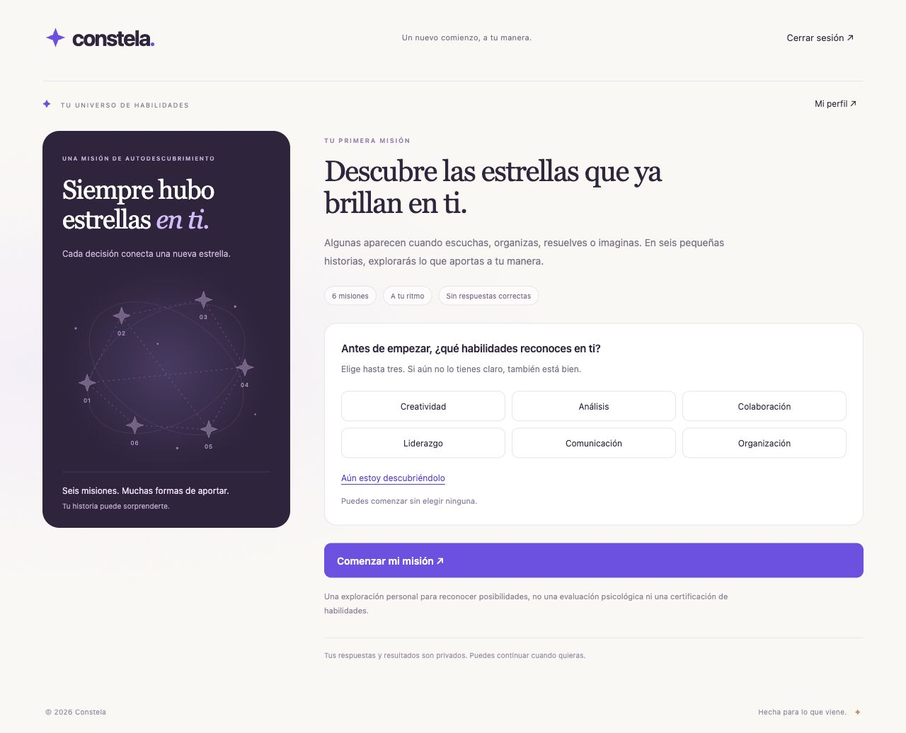

# CONSTELA

> **Warmi Innovathon 2026 · Grupo 1**
>
> **Eje 2: Orientación laboral — Talento visible y autonomía económica**
>
> Demo actual: local · Demo publicada: pendiente · Mentora: por confirmar



*Captura de la implementación local. La identidad visual es provisional.*

## El problema

El talento de muchas mujeres no se refleja en un CV tradicional, especialmente cuando no tienen experiencia formal o regresan al mercado laboral. El reto del equipo es hacer visibles sus capacidades y conectarlas con oportunidades de crecimiento y financiamiento. La población considerada incluye jóvenes sin experiencia formal, mujeres en reinserción laboral, profesionales en sectores masculinizados y emprendedoras.

Contexto y fuentes: [reto](docs/RETO.md) y [documento de trabajo del Grupo 1](https://docs.google.com/document/d/1ChiZJkQcohItuXl21GZ8o8ZgV1FMcWghAtaYn8sB8TY/edit).

## Nuestra solución

Constela es una plataforma web para descubrir habilidades, practicarlas y convertir experiencias en evidencias. El primer recorrido invita a reconocer fortalezas mediante situaciones cotidianas: la usuaria toma decisiones y conecta su constelación personal.

**¿Para quién es?** Mujeres que desean reconocer sus capacidades y acercarse a nuevas oportunidades, desde celular o computadora.

**¿Qué la hace distinta?** «La estrella que no veías» compara lo que la usuaria reconocía al inicio con las habilidades que aparecieron en sus decisiones. Los resultados son posibilidades por explorar, no un diagnóstico ni una certificación.

La versión actual implementa cuenta, perfil privado y misión de habilidades. Avatar, retos evaluados, portafolio y oportunidades pertenecen a [siguientes etapas](docs/ALCANCE.md).

## Demo

**Todavía no hay un enlace remoto publicado.** La aplicación funciona en la computadora donde se ejecuta el servidor.

Pruébala en tres pasos:

1. Inicia el servidor con `npm start` y abre [Crear cuenta](http://localhost:3000/registro). El proyecto local de desarrollo ya está conectado a Supabase.
2. Confirma el correo e [inicia sesión](http://localhost:3000/ingresar). El proveedor de correo actual admite pruebas con direcciones autorizadas del equipo de Supabase; falta SMTP para otras usuarias.
3. Recorre las seis misiones y revisa tus resultados. El progreso guardado se recupera al volver; desde **Mi perfil** puedes editar tu nombre y cerrar sesión.

La conexión y las pruebas reales se documentan en [estado de Supabase](docs/estado-supabase.md). No compartas credenciales de prueba en issues, capturas o PRs.

## Funcionalidades

Las casillas indican implementación existente, no aprobación humana ni despliegue público.

- [x] Registro, confirmación y acceso con correo. (001:RF-1 a RF-3, RF-10)
- [x] Sesión web, renovación y cierre de sesión. (001:RF-4, RF-7 a RF-9)
- [x] Lectura y edición del perfil propio. (001:RF-5, RF-6)
- [x] Percepción inicial y seis misiones equilibradas. (002:RF-1 a RF-3)
- [x] Progreso privado que se puede retomar. (002:RF-4, RF-5, RF-10)
- [x] Resultados con empates y «la estrella que no veías». (002:RF-6 a RF-8)
- [x] Reflexión final y ejercicios sugeridos. (002:RF-9, RF-11)

Detalles y estado de revisión: [índice de especificaciones](specs/README.md).

## Tecnologías

| Parte | Herramienta |
| --- | --- |
| Frontend | HTML, CSS, JavaScript y SVG |
| Backend | Node.js 22 o superior y Fastify |
| Autenticación y datos | Supabase Auth y PostgreSQL con RLS |
| Pruebas | `node:test`, Fastify inject y PGlite |
| CI | GitHub Actions: `npm ci`, `npm run check`, `npm test` |
| Despliegue | Servidor local; alojamiento remoto por definir |
| Asistencia de IA | Codex para implementación y verificación; reglas del repositorio para cualquier asistente |

## Cómo ejecutarlo

Esta adaptación se revisa en `codex/adaptar-plantilla-warmi`, basada en la rama funcional `codex/registro-usuarias`. `main` todavía no contiene la aplicación del PR #1.

```bash
git clone --branch codex/adaptar-plantilla-warmi https://github.com/mantunezdemayolosemi-sys/CONSTELA-Warmi-Innovathon.git CONSTELA
cd CONSTELA
npm ci
cp .env.example .env
```

Completa `.env` en tu computadora con la URL y la clave **publishable** de un proyecto Supabase autorizado. Nunca copies `.env` al repositorio ni uses una clave administrativa. En un proyecto nuevo aplica las dos migraciones en orden; en el proyecto de desarrollo actual **ya están aplicadas**.

```bash
npm start
```

Mantén esa Terminal abierta y entra a [http://localhost:3000/ingresar](http://localhost:3000/ingresar). `localhost` en otra computadora apunta a esa otra computadora. Para desarrollo con recarga automática existe `npm run dev`; si el observador falla con `EMFILE`, utiliza `npm start`.

```bash
npm run check
npm test
```

La suite actual tiene **43 pruebas automatizadas** y no necesita credenciales ni correos reales. Instrucciones completas de conexión, API y publicación: [guía técnica](docs/DESARROLLO.md).

## Cómo lo construimos

Adoptamos la estructura **Spec-Driven Development (SDD)** del kit de la Innovathon sobre una aplicación que ya estaba implementada. Las specs 001 y 002 documentan el comportamiento actual; el equipo debe revisarlas y aprobarlas. Para nuevos cambios, primero se acuerda la spec y después se implementa.

| Fase | Dónde queda |
| --- | --- |
| Principios | [Constitución](docs/constitution.md) |
| Reto y alcance | [Reto](docs/RETO.md) · [Siguientes etapas](docs/ALCANCE.md) |
| Requisitos | [Registro y perfil](specs/001-registro-perfil/spec.md) · [Universo de habilidades](specs/002-universo-habilidades/spec.md) |
| Plan y tareas | [Plan 001](specs/001-registro-perfil/plan.md) · [Tareas 001](specs/001-registro-perfil/tasks.md) · [Plan 002](specs/002-universo-habilidades/plan.md) · [Tareas 002](specs/002-universo-habilidades/tasks.md) |
| Código | [Interfaz](public/) · [Servidor](src/) · [Migraciones](supabase/migrations/) |
| Pruebas | [Suite](test/) · [Trazabilidad](docs/TRAZABILIDAD.md) · [CI](.github/workflows/test.yml) |
| Despliegue | [Guía técnica](docs/DESARROLLO.md) · Pendiente de publicación |
| Pitch | [Guion de trabajo](docs/pitch.md) |

## Cómo nos dividimos el trabajo

**Grupo 1.** Integrantes tomadas del documento compartido por el equipo:

| Integrante | Aporte o responsabilidad | GitHub |
| --- | --- | --- |
| Fatima de los Angeles Chavez Arce | Por acordar con el equipo | Pendiente |
| Mikella Cueva Marca | Por acordar con el equipo | Pendiente |
| Maricielo Antúnez de Mayolo Seminario | Avance actual de registro, datos y coordinación del prototipo | [@mantunezdemayolosemi-sys](https://github.com/mantunezdemayolosemi-sys) |
| Tyra Rivera Delgado | Por acordar con el equipo | Pendiente |

Nombre propio del equipo, mentora, usuarios de GitHub restantes y tablero de Projects: pendientes de confirmar. El reparto lo decide el equipo. La [guía de colaboración](CONTRIBUTING.md) propone cómo organizar tareas y revisiones sin asignarlas automáticamente.

## Cómo trabajamos

- Cada cambio funcional se relaciona con una spec y requisitos identificables.
- Las nuevas tareas se gestionan con un issue, una rama y un PR revisado por una compañera.
- El trabajo histórico conserva el vínculo al [PR #1](https://github.com/mantunezdemayolosemi-sys/CONSTELA-Warmi-Innovathon/pull/1); no se inventan issues ni aprobaciones retroactivas.
- La IA asiste; el equipo decide responsabilidades, aprobación y merge.

Reglas: [CONTRIBUTING.md](CONTRIBUTING.md) y [AGENTS.md](AGENTS.md). Flujo: [SDD](docs/FLUJO-SDD.md). Detalle de la incorporación del kit: [adaptación](docs/ADAPTACION-PLANTILLA.md).

## Checklist de entrega

- [x] Problema, solución, integrantes y estado del prototipo documentados.
- [x] Specs, planes, tareas y matriz de pruebas del comportamiento existente.
- [x] Comandos locales de comprobación y CI existentes.
- [x] Repositorio público y archivos de entorno excluidos de Git.
- [ ] Confirmar briefing, fechas, criterios del jurado y mentora.
- [ ] Confirmar GitHub de cada integrante y acordar tareas y revisiones.
- [ ] Revisar y aprobar specs y PRs; integrar a `main` mediante revisión humana.
- [ ] Crear tablero y tareas del siguiente incremento.
- [ ] Configurar SMTP y publicar demo HTTPS funcional.
- [ ] Ensayar pitch y demo, contrastando cifras de investigación con sus fuentes.
- [ ] Completar aportes y PRs revisados de todas las integrantes.

Créditos de la plantilla y aviso de licencia: [NOTICE.md](NOTICE.md).
